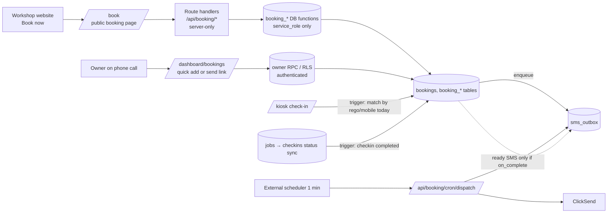

# Online Booking module — overview

> Status: owner answers applied 2026-11-03 (proposal "How it will work" table). Remaining open items are marked `PROPOSED` / `TBD` in BUSINESS_RULES.

Adds online booking + customer SMS to the existing Sai Motor Works check-in app, delivered in 7 days.
It is a **self-contained module** shaped like the future Torvio product, so Sai Motor Works can be moved onto Torvio later with a data copy, not a rebuild.

## Docs in this folder
| File | What |
|---|---|
| `BUSINESS_RULES.md` | Booking rules (the contract) |
| `DATA_MODEL.md` | New tables, DB functions, triggers, links to `checkins` / `jobs`, access rules |
| `API_SPEC.md` | Every route handler and RPC, with who can call it |
| `SECURITY.md` | Threats and controls specific to booking + SMS |
| `TASKS.md` | 7-day task list (vertical slices, test-first) |

## How it fits the existing app

1. **Book**: customer books on `/book` (or owner adds a phone booking) → `bookings` row `booked` → confirmation SMS queued.
2. **Day before**: reminder SMS queued by cron at 10:00.
3. **Drop-off day**: customer uses the existing **kiosk**. A trigger links the new check-in to today's booking (same rego or mobile) → booking `arrived`. The owner assigns the car and mechanics do the job sheet **exactly as today**.
4. **Job done**: the existing trigger sets the check-in `completed` → booking trigger sets booking `completed` and queues the **ready for pickup** SMS.

## Key decisions
| Date | Decision | Why |
|---|---|---|
| 2026-11-02 | Build inside `sai-motor-checkin`, Torvio later | 7-day deadline; check-in + jobs already exist |
| 2026-11-02 | Module isolation: own SQL file `supabase/booking.sql`, own tables (`bookings`, `booking_*`, `sms_outbox`), code under `src/lib/booking/`, `src/components/booking/`, routes `/book`, `/b/[token]`, `/dashboard/bookings`, `/api/booking/*`. Existing tables only get **triggers** added, no column changes (T6: the link is `bookings.checkin_id`, so not even `checkins.booking_id`) | Easy to lift into Torvio; low risk to the working app |
| 2026-11-02 | Single tenant (no `organisation_id`) | One workshop. Migration to Torvio adds it in the copy script |
| 2026-11-02 | Drop-off day model, capacity = cars per day | Owner's choice; matches the workshop |
| 2026-11-02 | Online bookings auto-confirm | Availability is enforced, so no approval step; owner can cancel |
| 2026-11-02 | Public booking actions go through **Next.js route handlers** calling DB functions with the **service role** (server-only). Anon gets no direct booking access | Rate limiting, bot checks and SMS sending need server code; keeps the ClickSend key off the browser |
| 2026-11-02 | Owner dashboard uses the browser Supabase client + RLS (`authenticated`), like the rest of the app | Matches existing code; owner is the only auth user |
| 2026-11-02 | Mechanics unchanged (shared staff PIN, no booking access) | Not needed for booking; avoids touching working flow |
| 2026-11-02 | SMS via transactional outbox + cron dispatcher (every minute) + immediate kick after public actions; ClickSend behind a provider interface; `SMS_MODE=log` outside production | Reliable retries; SMS failure never fails a booking; no real SMS in dev/preview |
| 2026-11-03 | Ready SMS is **button-only** (`ready_sms_mode = manual` by default): owner presses **Send ready SMS** on a booking or any check-in, walk-ins included. `on_complete` (auto on job Completed) stays as an option in Settings | Owner wants to send it when the car is really ready; mechanics may mark jobs Completed early |
| 2026-11-03 | Capacity 10 Mon–Fri / 8 Sat; no "I'll wait"; pink slip shows no price; send-link (Option B) in | Owner sign-off rows 4, 8, 11, 20 |
| 2026-11-07 | T8: open days must have a capacity (check constraints + form); `booking_on_date` is SECURITY INVOKER and owner-only; services are deactivated, never deleted; the last active drop-off time can't be turned off or removed | A Sunday opened without a capacity would just show "full"; RLS keeps applying; old bookings keep their service names; /book always has a window |
| 2026-11-06 | T7: customer and owner cancel/reschedule share internal SQL cores; `Referrer-Policy: no-referrer` + `X-Robots-Tag: noindex` for `/b/*` and `/api/booking/manage/*` set in `next.config.ts`; customer changes mark the booking unread | One copy of the locking/SMS logic; headers in the one place T9 extends; owner sees customer changes |
| 2026-11-06 | Dispatch (every minute) and reminders (every 15 min) are called by an external scheduler; `vercel.json` keeps only the daily retention job | Vercel Hobby allows daily crons only (deploy failed on `* * * * *`); routes and `CRON_SECRET` auth unchanged |

## Moving to Torvio later (for reference)
Copy `booking_settings` → organisation settings, `booking_services` → services, `bookings` → customers + vehicles + bookings (customer/vehicle split by mobile and rego), `sms_outbox` as is, adding `organisation_id` to every row.
